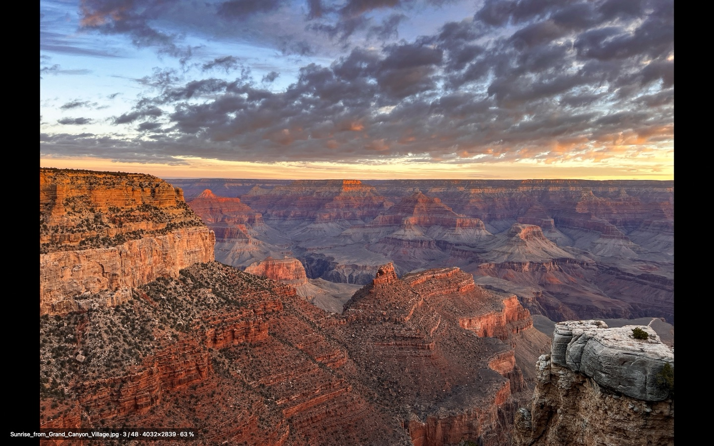

<p align="center">
  
</p>

<h1 align="center">Peekaboo</h1>

<p align="center">
  <strong>An ultra-fast, keyboard-first image viewer for macOS on Apple Silicon.</strong><br />
  The next photo is already decoded before you press the key. Sharp pixels in a frame, not a spinner.
</p>

<p align="center">
  <a href="https://github.com/thilllon/peekaboo/releases/latest/download/Peekaboo.dmg"><b>Download Peekaboo.dmg</b></a> ·
  <a href="https://thilllon.github.io/projects/peekaboo/">Website</a> ·
  <a href="docs/CONFIG.md">Configuration</a> ·
  <a href="docs/DESIGN.md">Design</a>
</p>

<p align="center">
  <a href="https://github.com/thilllon/peekaboo/actions/workflows/ci.yml"></a>
  <a href="https://github.com/thilllon/peekaboo/releases/latest"></a>
  
  <a href="./LICENSE"></a>
</p>

<p align="center">
  
</p>

## Why it is fast

Everything below was measured on a MacBook Pro M4 Pro (see [docs/research.md](docs/research.md)).

- **Hardware decoding, zero copies.** Baseline JPEGs go through the Apple Silicon JPEG engines (24 MP in 50 ms vs 109 ms for
  libjpeg-turbo), HEIC through the hardware HEVC decoder, and the decoded pixels are handed to the GPU without a single copy.
- **No slow format left behind.** PNGs go through Peekaboo's own decoder (inflate on one core, unfilter on another),
  about twice as fast as ImageIO with identical pixels: 24 MP in ~145 ms instead of ~300. Progressive JPEGs, which no
  hardware decodes, show their first-pass scans while the exact decode finishes on another core: a 101 MP photo looks
  sharp (52 dB) after 94 ms instead of 680 ms.
- **The next image is already there.** A predictive prefetcher schedules every decode by *when you will reach that image*,
  scales its look-ahead with how fast you browse, and switches to embedded previews while you hold an arrow key.
  On a 120-photo folder it hits 100 % of steps when browsing steadily and 96 % while holding an arrow key
  (XnView MP reads one image ahead). A prefetched image is a 0.3 ms GPU present, on glass ~6 ms later.
- **Low quality first, then exact.** Each image arrives in tiers — embedded preview, screen-size decode, full resolution — all
  drawn in one coordinate system, so a sharper tier never shifts the picture. Camera previews come straight out of the file:
  2–3 ms for JPEGs with an MPF preview, 10–34 ms for RAW (ARW, CR3, NEF, RAF, DNG).
- **A custom renderer (PPR).** A linear-light Lanczos-3 pyramid plus a residual resample keeps zoomed-out images as sharp as an
  offline Lanczos resize (48–74 dB PSNR) at a constant ≤ 3 ms per frame, at any zoom. While you pinch it draws a cheap
  trilinear frame and re-rasterises 90 ms after you stop.
- **Native and resident.** AppKit + Metal, no Electron, no SwiftUI; the first frame is committed ~80 ms after the process
  starts. Closing the window keeps the app warm, so the next open takes ~65 ms.

## Features

- Opens one file and browses its whole folder in Finder order; JPEG, HEIC, AVIF, PNG, WebP, TIFF, GIF, JPEG XL, PSD, EXR and
  camera RAW (embedded previews first).
- Keyboard-first, fully remappable in a TOML file that reloads as you save it; shortcuts keep working with non-Latin input
  methods (Korean, Japanese, …).
- Culling keys borrowed from Lightroom: 0–5 stars, 6–9 colour labels, P / X / U flags, Shift to act and advance — stored as
  Finder tags.
- Trash with undo, move/copy to configurable slots, reveal, copy path or image, open with your editor, shell templates.
- Instant (non-animated) full screen that respects the notch; HDR/EDR photos on XDR displays.
- Pinch/scroll zoom around the pointer, pixel-exact 100 %, pixel grid when you zoom far in.

## Install

1. Download [Peekaboo.dmg](https://github.com/thilllon/peekaboo/releases/latest/download/Peekaboo.dmg) and drag Peekaboo to
   Applications.
2. Peekaboo is ad-hoc signed and not notarized. On first launch macOS blocks it: open **System Settings → Privacy & Security**
   and click **Open Anyway** — or run `xattr -dr com.apple.quarantine /Applications/Peekaboo.app`.
3. Optional: make it the default viewer with Finder → Get Info → Open with → Peekaboo → Change All.

Requires macOS 26 (Tahoe) on Apple Silicon.

## Usage

Open an image from Finder (Open With → Peekaboo), drop files or a folder on the window or Dock icon, or press ⌘O.
Opening one image browses its whole folder.

| Keys | Action |
|---|---|
| → ↓ Space · ← ↑ ⌫ | next · previous |
| Home · End · `[` `]` | first · last · jump 10 |
| `z` / double-click · ⌘0 · ⌘1 · ⌘2 | fit ↔ 100 % · fit · 100 % · 200 % |
| `=` `-` · pinch · ⌘-scroll | zoom around the pointer |
| `f` / Return · Esc | instant full screen · leave |
| `i` · Tab · `b` · `?` | HUD (minimal → EXIF) · hide overlays · background · all shortcuts |
| `r` `shift+r` · `\|` `_` | rotate · flip |
| `0`–`5` · `6`–`9` · `p` `x` `u` (+Shift = and advance) | stars · colour labels · pick / reject / clear |
| ⌘⌫ · ⌘Z | move to Trash · undo |
| `m` · `c` · ⌥1–9 | move / copy to a slot |
| ⌘C · ⌥⌘C · ⇧⌘R · `e` | copy image · copy path · reveal in Finder · open in editor |

Every binding is configurable; the full table is in [docs/CONFIG.md](docs/CONFIG.md#default-keymap).

Command line: `peekaboo <image-or-folder> …` (installed into `~/.local/bin` by `mise run install`).

## Configuration

`~/.config/peekaboo/config.toml` — every key is optional, saving applies it live. Press ⌘, to open it.
See [docs/CONFIG.md](docs/CONFIG.md) for every option and action.

## Build from source

```sh
brew install jpeg-turbo   # statically linked
mise install              # pinned gitleaks + lefthook
mise run setup            # git hooks
mise run install          # build the release app into ~/Applications
```

`swift build`, `swift test`, `mise run app`, `mise run dmg`, `peekaboo-bench <decode|pipeline|render>`.

## How it works

| Module | Responsibility |
|---|---|
| `PeekabooCore` | decoding routes (ImageIO hardware paths, libjpeg-turbo lane, own PNG decoder, embedded previews), predictive prefetch scheduler, tiered cache, folder model, config & keymap |
| `CPeekabooDecode` | C decoders where ImageIO is slow: PNG (system zlib, two-thread pipeline), early renditions of progressive JPEGs |
| `PeekabooRender` | Metal renderer: zero-copy textures, Lanczos-3 pyramid, residual resampler, colour management, settle-time refinement |
| `PeekabooApp` | AppKit shell: window, input, HUD, full screen, file actions |
| `PeekabooBench` | performance regression CLI |

The decisions and the measurements behind them are in [docs/DESIGN.md](docs/DESIGN.md) and [docs/research.md](docs/research.md).

## License

[MIT](LICENSE)
